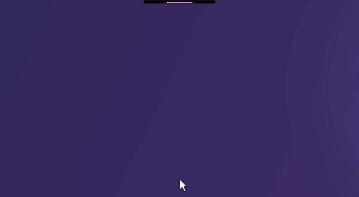

# Crest

A small island at the top of your Windows screen for whatever is playing, and for timing what you are doing.
It rests as a thin line, peeks when the song changes, and opens into a full panel when you hover over it.



**[Download Crest for Windows](https://github.com/allenJames777/crest-island/releases/latest)** · Windows 10 (version 1809 or later) and Windows 11, 64-bit.
Crest is **Windows only**: there is no Mac or Linux version.

## What it does

**Music**
- Shows the song, artist, album art and app for anything that reports to Windows' media controls: Spotify, YouTube in a browser, Apple Music and others.
- Play/pause, previous, next, shuffle, repeat, and a seek bar you can drag.
- Whole-PC volume: a slider and mute button in the open island, and the mouse wheel over the island.
- Several apps at once: it shows the one that is playing, and the app chip ("Spotify · 1 of 2") switches between them.

**Timers**
- Time what you are doing ("Studying", "Gym"). The stopwatch chip opens the Timers page: the running timer sits on top in large digits, the others below.
- Press **New timer**, type a name and press Enter. One timer runs at a time: starting another pauses it.
- Totals stay until you reset or delete a timer (each asks first). While a timer runs, the island rests as a small pill with the minutes (`● 42m`).
- A running timer pauses when the PC sleeps, when you sign out or shut down, and when you quit Crest.

**Your look, out of your way**
- Colours follow the album art; four themes plus your own colours, and adjustable transparency.
- Notch or Floating shape, roundness, size, position along the top edge, and which display it sits on.
- Tucks away (or hides) over full-screen apps, and uses almost no CPU or memory while idle.

## Install

1. Download `Crest.exe` from the [latest release](https://github.com/allenJames777/crest-island/releases/latest). It includes everything it needs; there is nothing else to install.
2. Put it somewhere you will keep it (for example `Documents\Crest`) and double-click it.
3. Windows may show **"Windows protected your PC"**, because Crest is not signed with a paid certificate. Click **More info**, then **Run anyway**.
4. Crest has no main window. Look for the island at the top of the screen and the purple pill icon in the tray (it may be under the **^** arrow by the clock).

To start Crest with Windows, right-click the island (or the tray icon) and tick **Start with Windows**.

## Using Crest

- **Hover** the island to open it; move away and it closes. (Settings can make it open on a click instead.)
- **Right-click** the island or the tray icon for the menu: Hide island, Settings, Start with Windows, Quit.
- **Mouse wheel** over the island changes the volume (over the timers list it scrolls the list).
- **Settings:** double-click the tray icon, or right-click > Settings. Changes apply at once.
- **Timers:** click the stopwatch chip on the music page, or hover the timer pill. The song chip on the Timers page goes back to the music.

Your keyboard's media keys control the app Windows treats as current; the island's buttons control the app the island shows.

## Your data

Crest never connects to the internet: no account, no tracking. Everything stays on your PC:

- Settings: `%APPDATA%\Crest\settings.json`
- Timers: `%APPDATA%\Crest\timers.json`

If either file is ever unreadable, Crest starts fresh and keeps the old one as `settings.bad.json` or `timers.bad.json`.

## Uninstall

1. Right-click the island, untick **Start with Windows**, then click **Quit**.
2. Delete `Crest.exe`, and the `%APPDATA%\Crest` folder if you want your settings and timers gone too.

## Questions

**Is there a Mac version?** No. Crest is built on Windows-only technology (WPF and Windows' own media controls). A Mac version would be a separate app.

**Why does my antivirus or SmartScreen warn about it?** New apps that are not signed with a paid code-signing certificate get this warning until enough people have run them. Crest only reads what is playing and your volume; it never connects to the internet.

**It does not show my music.** Crest shows apps that report to Windows' media controls. Most players and browsers do; if one does not, its music cannot appear in Crest.

## Build from source

Requires the [.NET 10 SDK](https://dotnet.microsoft.com/download/dotnet/10.0).

```powershell
dotnet build Crest.slnx
dotnet test Crest.slnx
dotnet publish src/Crest -c Release -r win-x64 --self-contained true -p:PublishSingleFile=true -p:EnableCompressionInSingleFile=true -p:IncludeNativeLibrariesForSelfExtract=true -o publish
```

The last command makes the same single `Crest.exe` as the download. Without `--self-contained true` the file is smaller but needs the [.NET 10 Desktop Runtime](https://dotnet.microsoft.com/download/dotnet/10.0) installed.

### Project layout

- `src/Crest/Island` - the island window, its state machine, theme colours and placement.
- `src/Crest/Media` - Windows media sessions, the session picker and the timeline.
- `src/Crest/Timers` - the timers, their time formats and the timers file.
- `src/Crest/Settings` - the settings model, its file and the Settings window.
- `src/Crest/Platform` - Win32 and Core Audio: full screen, displays, volume, start with Windows, and letting the island take the keyboard while a timer name is typed.
- `src/Crest/Tray` - the tray icon and menu.
- `tests/Crest.Tests` - unit tests for the logic.
